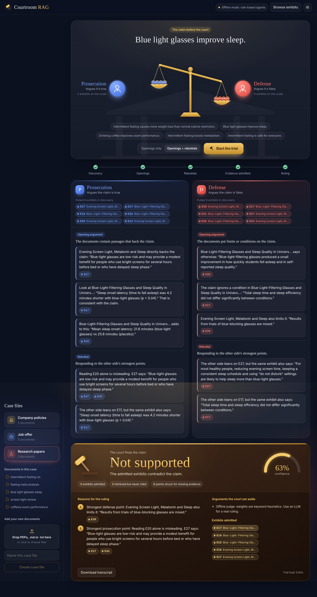
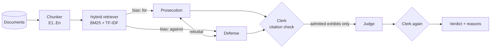

# ⚖️ Courtroom RAG

**Two AI lawyers argue over your documents. A third AI is the judge, and it's only allowed to look at the evidence they actually cited.**

Third-year mini project (B.Tech CSE, Sem 5/6). I wanted to understand RAG properly instead of just doing "chat with PDF" like everyone else, and I kept getting annoyed that normal RAG answers sound confident even when the documents say something different. So I made the model argue with itself.



---

## What it does

You give it a **claim** and a **folder of documents** (company policies, research papers, or even your own "should I take this job offer" notes).

1. **Discovery.** The Prosecution (argues the claim is TRUE) and the Defense (argues it's FALSE) each search the *same* documents. Their searches are slightly biased towards their own side (more on that below).
2. **Opening arguments.** Each side makes 2–4 points. Every point has to cite exhibit ids like `E12`.
3. **Rebuttals.** Each side attacks the other's points and is allowed to use the other side's exhibits against them.
4. **The clerk.** Plain Python, no AI. It checks every citation. If a point cites an exhibit that side never retrieved (i.e. the model made it up), the point is **struck from the record**.
5. **Ruling.** The judge only sees the claim, the surviving points and the **admitted exhibits**. It returns `SUPPORTED`, `NOT_SUPPORTED`, `MIXED` or `INSUFFICIENT`, with a confidence and reasons, and every reason must cite an admitted exhibit. If the judge cites something that wasn't admitted, that reason gets removed. If no reasons are left, the verdict is forced to `INSUFFICIENT`.

The idea: hallucinations have to get past an opponent *and* a citation check before they can affect the answer.



## Case files (included)

Two case files use **real, publicly published policy PDFs**:

| Case file | Docs | Good claims to try |
|---|---|---|
| `apple_policies` | Apple's Business Conduct, Global Whistleblowing, Human Rights and Antitrust policies | *"Apple employees can create and sell their own apps on the App Store."* |
| `reliance_governance` | 8 Reliance Industries governance policies: dividends, related party transactions, directors' selection and pay, whistle-blower, material subsidiaries, disclosures, debentures | *"Reliance must pay a dividend to shareholders every year."* |

Real PDFs needed extra cleaning in `ingest.py`: lines broken mid-sentence get glued back into paragraphs, table-of-contents dot leaders are removed, ALL-CAPS lines become section headings, and headers/footers that repeat on every page are dropped.

### Synthetic case files

I wrote three sets of **synthetic** documents so it works out of the box. All companies, people, papers and numbers are made up.

| Case file | Docs | Good claims to try |
|---|---|---|
| `company_policies` | remote work, leave, expenses, infosec, a Slack FAQ for a fake company "Nimbus Labs" | *"An employee can work from Dubai for three weeks if their manager approves."* |
| `research_papers` | fasting RCT + meta-analysis, blue-light glasses trial + review, caffeine & exams cohort | *"Blue light glasses improve sleep."* |
| `job_offer` | offer letter, my notes, current job, company research, budget comparison | *"I should accept the Quillstack offer."* |

The docs are written so that the claims are actually debatable. For example, the FAQ says "yes" to working from another city, but the policy has a 14-day limit for working abroad. Both lawyers have real ammunition.

You can also **upload your own PDFs / .md / .txt** from the sidebar. Each upload becomes a new case file.

## Running it

```bash
git clone <this repo>
cd courtroom-rag
python -m venv venv
venv\Scripts\activate          # windows
# source venv/bin/activate     # mac / linux
pip install -r requirements.txt
cp .env.example .env           # then edit it (see below)
python app.py
```

Open **http://localhost:8000**.

Or just double-click `run.bat` (Windows) / run `./run.sh`.

### Choosing a model

Edit `.env`:

```ini
# free + fast, what I used for the demo. get a key at console.groq.com
LLM_PROVIDER=groq
LLM_API_KEY=gsk_xxxxxxxx
LLM_MODEL=openai/gpt-oss-120b      # or openai/gpt-oss-20b (faster, weaker)

# or fully local with ollama (no internet needed after the model download)
# LLM_PROVIDER=ollama
# LLM_MODEL=llama3.1

# or openai
# LLM_PROVIDER=openai
# LLM_API_KEY=sk-...
# LLM_MODEL=gpt-4o-mini
```

With `LLM_PROVIDER=offline` (the default) there's **no AI at all**. The lawyers pick sentences with keyword rules and the judge scores the admitted exhibits with a stance lexicon. It's there so the demo still works when the API is down or the free quota runs out. It's also a baseline to compare the LLM against.

Model names change often (llama-3.3-70b-versatile got shut down on Groq's free tier in Aug 2026, which broke my demo the week before review 💀). If Groq says a model is decommissioned, check console.groq.com/docs/models and put the current one in `LLM_MODEL`.

## Deploying (Render)

One service runs everything: the Python backend and the website.

**1. Put the code on GitHub.** Upload everything except `.env` (your key) and `venv/`.

**2. Deploy on Render (free).** Go to render.com and sign in with GitHub, then New → **Blueprint**, and pick the repo. `render.yaml` sets everything up. When it asks, paste your Groq key into `LLM_API_KEY` and click Apply. After ~3–5 min the status turns **Live**. Open the URL (e.g. `https://courtroom-rag.onrender.com`).

Things to know about the free tier:
- It **sleeps after 15 min idle**. The first visit after that takes about a minute (the UI shows a "waking up" message). Open the site a couple of minutes before your demo.
- The disk is temporary, so **uploaded documents disappear** on restart. The sample case files are in the repo, so they're always there. Set `ALLOW_UPLOADS=false` if you don't want uploads on the public site.
- Anyone with the link uses *your* Groq key, so there's a per-IP limit (`TRIALS_PER_HOUR`, default 30).

## How retrieval works (and why no vector DB)

- **Chunking:** paragraph-aware, ~110 words. Headings are kept as `section` so every exhibit knows where it came from. My first version split every N words and kept cutting "...is **not** permitted" right before the "not", which flipped the meaning 🙃
- **BM25:** written from scratch in `retriever.py` (it's like 30 lines).
- **TF-IDF:** sklearn, unigrams + bigrams, cosine similarity.
- **Hybrid score:** `0.55 * bm25 + 0.45 * tfidf` after min-max normalisation.
- **Stance bias:** each chunk gets a support score and an oppose score from a small cue-word list (`allowed`, `eligible` vs `not`, `except`, `only`, `however`...). The prosecution's ranking is boosted by up to 25% for supportive chunks and the defense's for opposing ones. If the boost is any bigger, the defense starts pulling random paragraphs that just say "not" a lot.
- **Per-doc cap:** max 3 exhibits from one file, so one long document can't take over the case.
- **Synonyms:** small hand-made map (`wfh → remote`, `dubai/abroad → outside india`, `payout → encash`). This fixed most of my failing queries.

I did try `sentence-transformers` embeddings. They work, but with torch it's a ~2 GB install and it was slow on the college lab PCs. On these docs exact words matter a lot ("14 days", "intern", "encash") and BM25 was honestly just as good. Adding embeddings back as an option is on the TODO list.

## Evaluation

`eval/expected.csv` has 28 claims (16 on the synthetic case files, 12 on the real Apple and Reliance policies) with the verdict I think is correct after reading the docs (a few accept two answers because they're genuinely debatable).

```bash
python eval/run_eval.py
```

| Mode | Correct |
|---|---|
| Offline (rule-based) | 13 / 28 (46%) |
| Groq gpt-oss-120b | _run it and fill this in_ |

The offline judge is biased towards `NOT_SUPPORTED`. Negation words are strong signals in policies, but in research papers they show up everywhere ("no significant difference in secondary outcomes") even when the main result is positive. That's basically the whole argument for using an LLM.

Tests: `pytest -q` (8 tests). They include a fake LLM that invents exhibit `E777`, to check that the clerk strikes it and the judge can't use it.

## Project structure

```
courtroom-rag/
├── app.py                  FastAPI server + SSE stream
├── courtroom/
│   ├── config.py           settings from .env
│   ├── ingest.py           load .md/.txt/.pdf, chunk, assign E-ids
│   ├── text_utils.py       tokenizer, stemmer, synonyms, stance cue words
│   ├── retriever.py        BM25 + TF-IDF hybrid, stance bias
│   ├── llm.py              OpenAI-compatible client (groq/openai/ollama)
│   ├── prompts.py          prompts for lawyers + judge
│   ├── agents.py           Advocate + Judge (LLM and offline versions)
│   ├── citations.py        the "clerk": validates citations
│   └── trial.py            runs the trial, yields events
├── static/                 the UI (plain HTML/CSS/JS, no build step)
├── render.yaml             Render deploy config
├── data/                   sample case files + your uploads
├── eval/                   expected verdicts + eval script
├── tests/
└── notes/dev_log.md        what broke and how I fixed it
```

## UI notes

- The UI streams the trial live over Server-Sent Events, so you see discovery → openings → rebuttals → ruling as they happen.
- The **scales of justice** in the middle are live: every exhibit a side cites drops a coin into their pan, the heavier pan sinks, and on the verdict the scales tip to the winner. The ruling gets stamped on with a gavel strike.
- Night-court dark theme by default (navy chamber, brass, mahogany bench), light theme on the toggle.
- Exhibit tags are colour-coded like real court exhibit stickers: blue = prosecution, red = defense, brass = judge. Click any tag to read the full passage, with your claim's words highlighted and a record of who retrieved and cited it.
- Struck points are shown crossed out, so you can actually *see* the hallucination check working.
- **Browse exhibits** shows every chunk in the case file (handy for debugging chunking).
- **Download transcript** exports the whole trial as markdown (that's what I pasted into my report).
- Works on mobile, `Ctrl+Enter` starts a trial.

## Limitations / known issues

- The judge is still an LLM. Ruling only on cited evidence reduces hallucination but doesn't make it right. It can still misread an exhibit.
- Both lawyers use the same model, so they share the same blind spots.
- The stance cue words are English-only and hand-picked.
- PDF extraction is plain `pypdf`, so scanned PDFs (images) won't work and tables come out messy.
- No conversation memory: each trial is independent.

## TODO

- [ ] optional embedding retriever (bge-small?) + compare in eval
- [ ] let the judge ask each side one question before ruling
- [ ] save past trials
- [ ] use a different model for the judge than for the lawyers

## Credits

BM25 formula from Robertson & Zaragoza, *The Probabilistic Relevance Framework: BM25 and Beyond* (2009). The "make two models debate" idea is inspired by the AI-safety-via-debate papers (Irving et al., 2018). Fonts: Gloock + Instrument Sans (Google Fonts).
